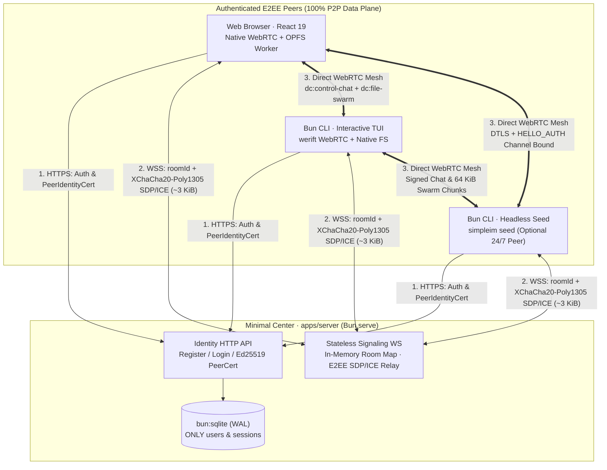

# SimpleIM

**Lightweight hybrid-P2P end-to-end encrypted instant messaging and BitTorrent-style swarm file sharing across Web and CLI, built with Bun & TypeScript.**

[](https://bun.sh)
[](https://www.typescriptlang.org/)
[](docs/contracts/p2p-v1.md)
[](LICENSE)

[Why SimpleIM](#why-simpleim) · [Highlights](#highlights) · [Quickstart](#quickstart) · [System Architecture](#system-architecture) · [Repository Layout](#repository-layout) · [Documentation Map](#documentation-map) · [License](#license)

> **Status**: **v1 complete** across `packages/contracts`, `packages/crypto`, `packages/peer-core`, `apps/server`, `apps/cli`, `apps/web`, cross-runtime Playwright E2E, CI, and `deploy/`. Specification: [Issue #1](https://github.com/zzqDeco/SimpleIM/issues/1).

---

## Why SimpleIM

Pure serverless P2P tools suffer from slow public-DHT rendezvous (`3–15s`), brittle browser compatibility, and cumbersome seed-phrase onboarding; traditional centralized chat servers store user conversations, bottleneck file transfers on server bandwidth, and turn into high-value data targets.

SimpleIM combines a **tiny, zero-knowledge Bun rendezvous center** with a **100% peer-to-peer WebRTC data plane**:

- **Authenticated Identity Without Central Chat Storage**: Users register and sign in normally on the central server (`apps/server`) to obtain a short-lived, `Ed25519`-signed `PeerIdentityCert`. Once connected over WebRTC, peers verify each other's certificates offline using the server's public key—preventing impersonation even among users who know the room passphrase.
- **Same Passphrase = Same Encrypted Group**: Entering an identical passphrase in either the **Web app** or the **Bun CLI** locally derives an orthogonal `roomId` (`Argon2id` + `HKDF-SHA256`) for sub-second WebSocket rendezvous and end-to-end keys (`XChaCha20-Poly1305`) that encrypt even SDP/ICE signaling frames.
- **Center Detaches After Handshake**: As soon as WebRTC `RTCDataChannel`s open and pass DTLS-bound `HELLO_AUTH` verification, all messages, online history sync, and multi-gigabyte file chunks travel directly peer-to-peer. Even if the central server restarts or disconnects, active rooms keep chatting and transferring files uninterrupted.

---

## Highlights

| Pillar | Capabilities |
| :--- | :--- |
| **Web ↔ CLI Native Interop** | Browser `RTCPeerConnection` (`apps/web`) and pure-TypeScript `werift` (`apps/cli`, zero `node-gyp` C++ addons, single-binary `bun build --compile`) speak the exact same wire protocol |
| **Zero-Knowledge Passphrase Rooms** | Client-only `Argon2id` (`64 MiB`) + `HKDF-SHA256` key separation; encrypted SDP/ICE signaling; post-DTLS `HELLO_AUTH` mutual channel binding blocking server MITM |
| **Swarm Distributed File Transfer** | `64 KiB` binary chunks on a dedicated unordered `"file-swarm"` channel, `SHA-256` per-chunk verification, Rarest-First + Endgame multi-peer pulling, and SCTP backpressure guards |
| **Constant-Memory Large Files** | Web Worker **OPFS (`FileSystemSyncAccessHandle`)** random-offset chunk I/O in browsers and sparse `.part` files on CLI—no multi-GB RAM buffering |
| **Optional Headless Seed Peer** | Run `simpleim seed` on any VPS or NAS as an ordinary encrypted room peer to provide 24/7 online history catch-up and file seeding with zero server changes |

---

## Quickstart

Requires **Bun >= 1.4**:

```bash
bun install

# 1. Start the minimal zero-knowledge identity & signaling server (port 3000)
bun run --cwd apps/server dev

# 2. Start the React 19 + Web Worker (Argon2id + OPFS) web client (port 5173)
bun run --cwd apps/web dev

# 3. Join the same passphrase room from the CLI (or compile standalone binary)
bun run build:cli
./apps/cli/bin/simpleim register --server http://127.0.0.1:3000 --username cli_bob
printf 'shared-room-secret\n' | ./apps/cli/bin/simpleim join --server http://127.0.0.1:3000 --passphrase-stdin
```

Run the full verification matrix locally:

```bash
bun run typecheck     # Strict TypeScript checks across all 6 workspace packages/apps
bun test              # Architecture AST gate + crypto vectors + server SQLite + 4-peer WebRTC mesh E2E
bun run test:e2e      # Real Headless Chromium (OPFS) <-> CLI (werift) Playwright E2E suite
```

For single-host production deployment with Docker Compose, automatic HTTPS Caddy, and optional `coturn`, see [`deploy/README.md`](deploy/README.md).

> **Restricted Container / Sandbox Note (`apps/cli`)**: Direct WebRTC DataChannels require outbound UDP (or TCP/TLS TURN via `coturn` when UDP is blocked). In restricted Linux containers where `os.networkInterfaces()` (`getifaddrs`) is unavailable, `WeriftTransportFactory` automatically disables host NIC enumeration and `.local` mDNS multicast lookups, falling back cleanly to explicit host / STUN / TURN candidates without crashing.

---

## System Architecture



---

## Repository Layout

```text
simpleim/
├── apps/
│   ├── server/           # Minimal Bun.serve() HTTP auth + stateless WebSocket signaling center
│   ├── web/              # React 19 SPA client (Browser WebRTC + Web Worker OPFS chunk store)
│   └── cli/              # Bun CLI client & headless seed daemon (werift WebRTC + FS chunk store)
├── packages/
│   ├── contracts/        # Single source of truth for HTTP, WS signaling & P2P wire schemas
│   ├── crypto/           # Isomorphic Argon2id, HKDF, XChaCha20-Poly1305 & Ed25519 primitives
│   └── peer-core/        # Platform-agnostic P2P mesh, HELLO_AUTH, chat sync & Swarm scheduler
├── docs/
│   ├── architecture/     # Topology, trust model & non-negotiable system guarantees
│   ├── contracts/        # HTTP/WS signaling v1 and P2P DataChannel/Swarm v1 wire specs
│   └── product/          # Release scope, explicit non-goals & acceptance matrix
├── deploy/               # Single-host Docker Compose + Caddy (+ optional coturn) deployment
├── AGENTS.md             # Non-negotiable engineering & security invariants
└── CONTRIBUTING.md       # Clean architecture layers, verification matrix & PR workflow
```

---

## Documentation Map

- **Engineering Invariants**: [`AGENTS.md`](AGENTS.md)
- **Contributing & Clean Architecture Rules**: [`CONTRIBUTING.md`](CONTRIBUTING.md)
- **Architecture & Security Guarantees**: [`docs/architecture/overview.md`](docs/architecture/overview.md)
- **Signaling & Identity Contract (v1)**: [`docs/contracts/signaling-v1.md`](docs/contracts/signaling-v1.md)
- **P2P Mesh, E2EE & Swarm File Contract (v1)**: [`docs/contracts/p2p-v1.md`](docs/contracts/p2p-v1.md)
- **Phase 1 Scope & Acceptance**: [`docs/product/phase-one.md`](docs/product/phase-one.md)

---

## Roadmap

Tracked in [Issue #1 (SimpleIM v1 Master Implementation Plan)](https://github.com/zzqDeco/SimpleIM/issues/1):

1. **Phase 1**: Workspace scaffold, `packages/contracts`, `packages/crypto`, and `arch.test.ts` import-boundary gate
2. **Phase 2**: `apps/server` minimal identity (`bun:sqlite` + `Ed25519` `PeerIdentityCert`) & stateless encrypted signaling relay
3. **Phase 3**: `packages/peer-core` deterministic mesh, DTLS-bound `HELLO_AUTH`, signed chat catch-up, and Swarm chunk scheduler
4. **Phase 4**: `apps/cli` interactive terminal UI, `simpleim seed` daemon, and standalone compiled binary
5. **Phase 5**: `apps/web` React 19 workspace, Web Worker KDF, and OPFS zero-RAM-bloat Swarm file transfer UI
6. **Phase 6**: Cross-runtime (Web ↔ CLI) E2E suite, GitHub Actions CI, and single-host production Compose delivery

---

## License

Copyright (c) 2026 Ziqian Zhao. Licensed under [`FSL-1.1-MIT`](LICENSE) (converts automatically to MIT two years after each version's publication).
