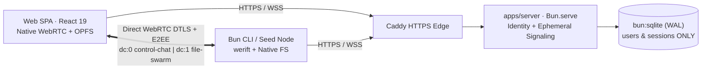

# Hybrid-P2P architecture and security guarantees

SimpleIM separates **account authentication & rendezvous** (`apps/server`) from **encrypted group communication & distributed file sharing** (`packages/peer-core` across `apps/web` and `apps/cli`). Once WebRTC `RTCDataChannel`s open, the central server drops completely out of the data path.

## Module ownership

| Module | Owns |
| :--- | :--- |
| `packages/contracts` | Canonical HTTP DTOs, WebSocket signaling frames, P2P control envelopes, binary chunk frame layout, and strict validation |
| `packages/crypto` | Isomorphic `Argon2id` + `HKDF-SHA256` room key derivation, `XChaCha20-Poly1305` signaling/application AEAD, `Ed25519` `PeerIdentityCert` verification and message signing |
| `packages/peer-core` | Deterministic full-mesh orchestration, `HELLO_AUTH` DTLS channel-binding handshake, Lamport-ordered signed chat + online catch-up, and Rarest-First Swarm file scheduler |
| `apps/server` | Self-service user registration/login, session hashes (`bun:sqlite`), `Ed25519` `PeerIdentityCert` signing, rate limits, and in-memory `roomId` WebSocket relay |
| `apps/web` | Browser UI, session/tab isolation, Web Worker KDF, native `RTCPeerConnection` adapter, and OPFS `FileSystemSyncAccessHandle` chunk storage |
| `apps/cli` | Interactive TUI (`simpleim join`), headless daemon (`simpleim seed`), `0600` credential store, `werift` WebRTC adapter, and sparse `.part` file chunk storage |

## Core guarantees

1. **Zero Server Room/Message/File Persistence**: `apps/server` persists only `schema_migrations`, `users`, and `sessions`. Room tables exist exclusively in process RAM while WebSockets are open; stopping a room leaves zero trace on the server.
2. **Offline-Verifiable Authenticated Identity**: Server-signed `PeerIdentityCert` binds a user's `userId` and `username` to a client-held ephemeral `Ed25519` public key (`peerSignPubKey`). Peers verify each other directly over WebRTC using `serverSignPubKey` without round-tripping to the server.
3. **Zero-Knowledge Passphrase & Encrypted Signaling**: The passphrase never leaves the client. `Argon2id` (`64 MiB`) + domain-separated `HKDF-SHA256` produce independent `roomId` (for rendezvous) and `signalingKey` (encrypting SDP/ICE payloads with `XChaCha20-Poly1305` before they touch the server). Plaintext usernames are never announced in server WebSocket events.
4. **Post-DTLS Channel Binding (`HELLO_AUTH`)**: Before any chat or file frame is accepted, peers exchange `PeerIdentityCert`, an HMAC under `roomAuthKey`, and an `Ed25519` signature over a transcript containing both peers' observed DTLS certificate `SHA-256` fingerprints—preventing a compromised signaling relay from mounting an active SDP MITM attack.
5. **Center-Detached Liveness**: Active `RTCDataChannel` meshes survive WebSocket disconnection or `apps/server` restarts. The signaling WebSocket is needed only when new peers enter a room or a disconnected peer re-joins.
6. **Head-of-Line Isolation & Poison-Proof Swarm Delivery**: Ordered control/chat messages (`dc:0`) are physically isolated from unordered `64 KiB` binary file chunks (`dc:1`). Every incoming chunk is verified against its signed `FileManifest` `SHA-256` digest prior to OPFS/disk write, enabling safe multi-peer concurrent pulling and immediate re-seeding.
